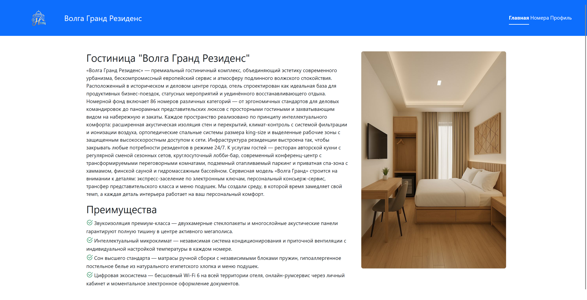
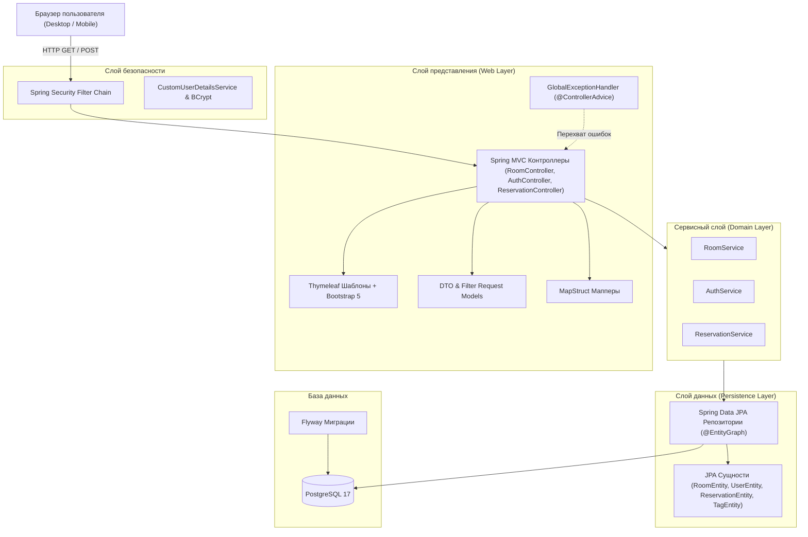
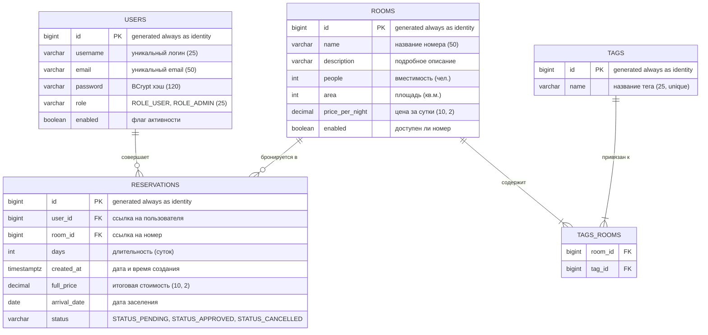
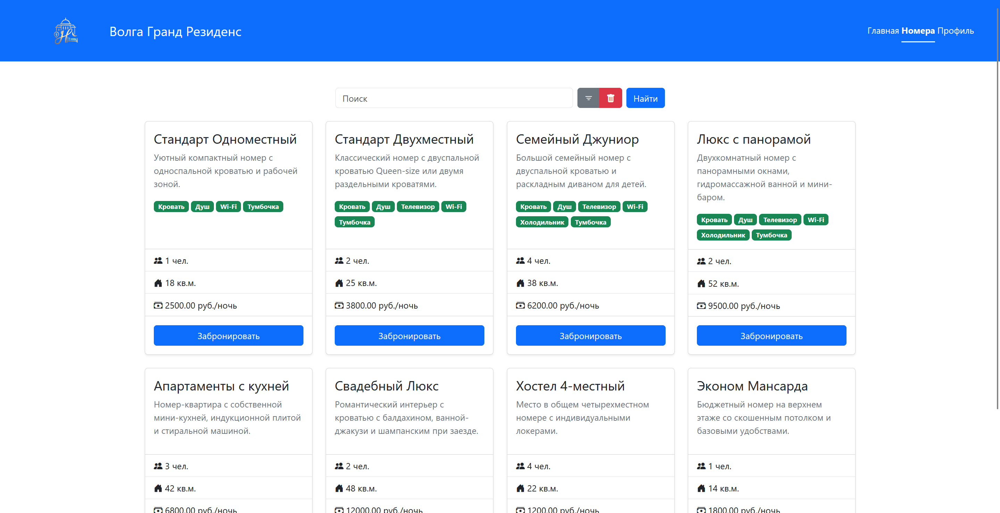
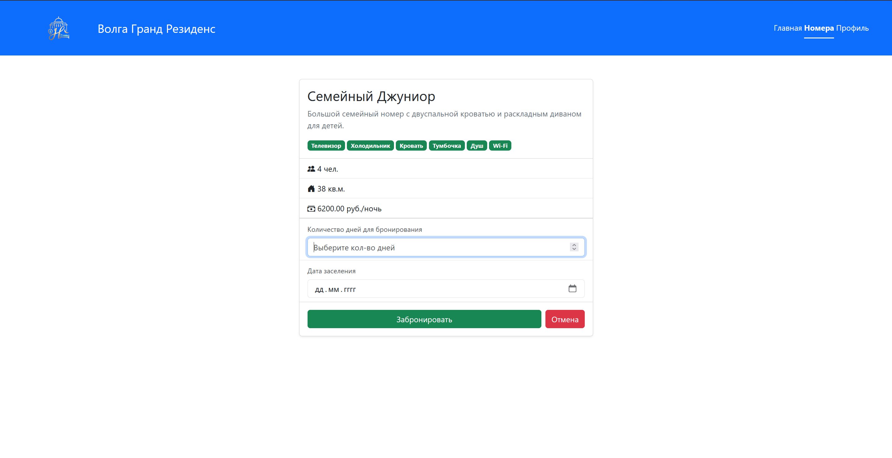
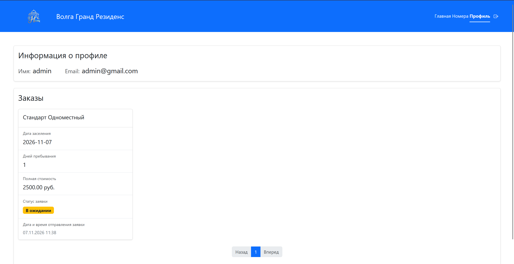
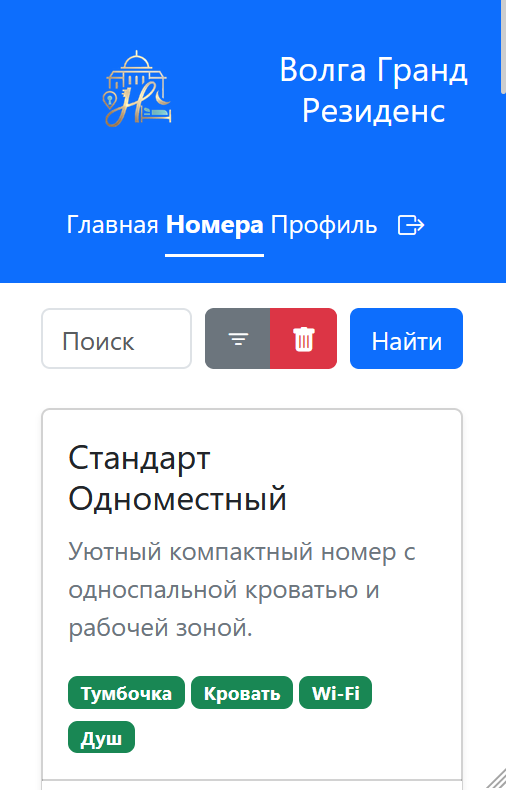
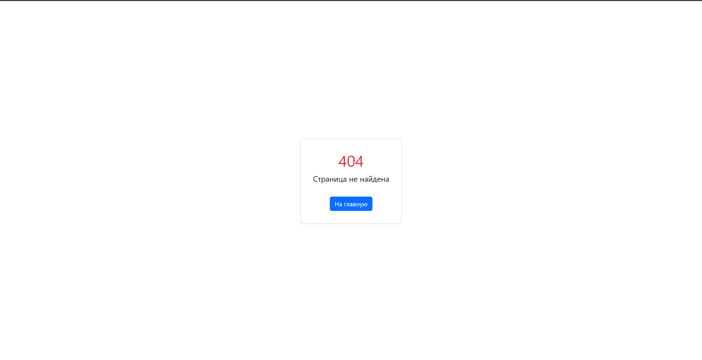

# 🏨 Веб-приложение бронирования номеров гостиницы «Волга Гранд Резиденс»

[](https://www.oracle.com/java/)
[](https://spring.io/projects/spring-boot)
[](https://www.postgresql.org/)
[](https://www.docker.com/)
[](https://getbootstrap.com/)
[](https://flywaydb.org/)

Полнофункциональное веб-приложение для гостиничного комплекса «Волга Гранд Резиденс», разработанное на базе **Spring Boot** и **Thymeleaf**. Сервис предоставляет гостям возможность ознакомиться с отелем, просматривать каталог номеров с фильтрацией, бронировать апартаменты на выбранные даты, отменять свои бронирования и отслеживать историю заказов в личном кабинете. Приложение полностью контейнеризировано с помощью **Docker** и **Docker Compose**.

---

> [!TIP]
> 

---

## 📌 Основные возможности

- 🏠 **Главная страница**: презентация отеля, описание премиальных услуг, ключевых преимуществ и фотогалерея.
- 🛏️ **Каталог номеров**:
  - Полнотекстовый поиск по названию номера (по подстроке).
  - Модальный фильтр по диапазону цен (от / до), площади (кв.м.) и количеству гостей.
  - Постраничная навигация (пагинация) с сохранением текущих параметров фильтра.
  - Отображение тегов-удобств (Wi-Fi 6, вид на реку, кондиционер, джакузи и т.д.).
- 📅 **Бронирование номера**:
  - Выбор даты заселения с валидацией (нельзя выбрать дату в прошлом).
  - Выбор длительности проживания (от 1 до 30 дней).
  - Автоматический точный расчет стоимости через `BigDecimal.multiply()`.
  - Защита от овербукинга и повторного бронирования недоступных номеров.
- ❌ **Отмена бронирования**:
  - Пользователь может отменить активную бронь (`STATUS_PENDING`) прямо из личного кабинета.
  - При отмене статус переводится в `STATUS_CANCELLED`, а номер мгновенно становится доступным для других гостей.
  - Проверка безопасности: пользователь может отменять только свои бронирования.
- 👤 **Аутентификация и личный кабинет**:
  - Регистрация с проверкой уникальности логина и email.
  - Безопасная авторизация на базе **Spring Security** с хэшированием паролей **BCrypt**.
  - Личный кабинет с информацией о пользователе и постраничным списком всех совершенных бронирований.
  - Статусы бронирования (`В ожидании`, `Принято`, `Закрыто`) и форматирование даты создания заявки (МСК).
- 🛡️ **Централизованная обработка ошибок**:
  - Перехват исключений через `@ControllerAdvice` (`GlobalExceptionHandler`).
  - Flash-сообщения (паттерн **Post-Redirect-Get**) при ошибках и успешных действиях.
  - Красивая кастомная страница ошибок (404, 500) с кнопкой возврата на главную.
- 📱 **Адаптивный дизайн (Mobile-First)**:
  - Полная поддержка смартфонов, планшетов и широкоформатных мониторов на Bootstrap 5.

---

## 🛠 Технологический стек

### Backend
- **Язык**: Java 21 (LTS)
- **Фреймворк**: Spring Boot 3.x / 4.x
- **Безопасность**: Spring Security (Session-based, BCrypt, CSRF)
- **Работа с данными**: Spring Data JPA, Hibernate ORM
- **Маппинг**: MapStruct 1.6 (автоматическое преобразование Entity ⇄ DTO)
- **Утилиты**: Project Lombok, SLF4J / Logback

### База данных и миграции
- **СУБД**: PostgreSQL 17
- **Миграции**: Flyway (версионирование схемы БД в SQL)

### Frontend
- **Шаблонизатор**: Thymeleaf + Thymeleaf Extras Spring Security
- **UI фреймворк**: Bootstrap 5.3
- **Иконки**: Bootstrap Icons
- **Стилизация**: Адаптивный Flexbox & Grid

### Инфраструктура и контейнеризация
- **Контейнеризация**: Docker (многоэтапная сборка Multi-stage build)
- **Оркестрация**: Docker Compose (сервисы `app` и `postgres`)
- **Сборщик проекта**: Apache Maven

---

## 📐 Архитектура системы

Проект спроектирован по классической многослойной архитектуре (Layered Architecture):



---

## 🗄️ Схема базы данных (ER-диаграмма)

Схема базы данных автоматически разворачивается через Flyway-миграцию `V1__init_db.sql`:



> [!NOTE]
> Для предотвращения проблемы **N+1 запросов** в методах выборки репозиториев используются аннотации `@EntityGraph(attributePaths = {"tags"})` для номеров и `@EntityGraph(attributePaths = {"room", "room.tags"})` для бронирований.

---

## 📸 Галерея интерфейса

|                 Главная страница                 |                 Каталог номеров                  |
|:------------------------------------------------:|:------------------------------------------------:|
| ** | ** |

|                 Карточка и бронирование                  |             Личный кабинет с отменой              |
|:--------------------------------------------------------:|:-------------------------------------------------:|
| ** | ** |

|                  Мобильная версия сайта                  |           Страница ошибок (404 / 500)            |
|:--------------------------------------------------------:|:------------------------------------------------:|
| ** | ** |

---

## 🚀 Быстрый старт и запуск проекта

### Вариант 1. Запуск всей системы в Docker (Рекомендуемый)
Весь проект (и PostgreSQL, и Spring Boot приложение) поднимается **одной командой**:

```bash
docker compose up --build -d
```
После завершения сборки веб-приложение сразу готово к работе по адресу:  
👉 **[http://localhost:8080](http://localhost:8080)**

Остановка контейнеров:
```bash
docker compose down
```

---

### Вариант 2. Локальный запуск (для разработки)

#### 1. Запуск только базы данных:
```bash
docker compose up -d postgres
```

#### 2. Запуск Spring Boot приложения:
**Windows (PowerShell / CMD):**
```powershell
.\mvnw.cmd spring-boot:run
```

**Linux / macOS:**
```bash
./mvnw spring-boot:run
```

Перейдите в браузере на: **[http://localhost:8080](http://localhost:8080)**

---

## 🧪 Первоначальное наполнение тестовыми данными (Seed Data)

При первом старте база данных пуста. Добавьте демонстрационные номера и теги, выполнив SQL-скрипт (через `docker exec`, DBeaver или IntelliJ Database Tool):

```sql
-- 1. Создание тегов
INSERT INTO tags (name) VALUES 
('Wi-Fi 6'), 
('Вид на Волгу'), 
('Кондиционер'), 
('King-size кровать'), 
('Джакузи'), 
('Завтрак включен');

-- 2. Создание номеров
INSERT INTO rooms (name, description, people, area, price_per_night, enabled) VALUES 
('Стандарт Уют', 'Компактный и светлый номер для деловой поездки или отдыха вдвоем.', 2, 24, 4500.00, true),
('Комфорт Плюс', 'Просторный номер с рабочей зоной и панорамным окном.', 2, 35, 6800.00, true),
('Семейный Люкс', 'Двухкомнатный номер с большой гостиной для комфортного семейного отдыха.', 4, 58, 11500.00, true),
('Президентский Люкс', 'Роскошные апартаменты на верхнем этаже с джакузи и панорамным видом на реку.', 3, 90, 24000.00, true);

-- 3. Связка номеров и тегов
INSERT INTO tags_rooms (room_id, tag_id) VALUES 
(1, 1), (1, 3),
(2, 1), (2, 2), (2, 3), (2, 4),
(3, 1), (3, 3), (3, 4), (3, 6),
(4, 1), (4, 2), (4, 3), (4, 4), (4, 5), (4, 6);
```

---

## 📂 Структура проекта

```
src/main/
├── java/com/fraus/hotel/
│   ├── HotelApplication.java              # Точка входа Spring Boot
│   ├── auth/                             # Модуль авторизации и профиля
│   │   ├── config/SecurityConfig.java    # Настройки Spring Security
│   │   ├── domain/                       # AuthService, CustomUserDetailsService
│   │   └── web/                          # AuthController, DTOs
│   ├── reservation/                      # Модуль бронирования и отмены
│   │   ├── domain/                       # ReservationService, Сущности, Репозиторий
│   │   └── web/                          # ReservationController, DTOs, Мапперы
│   ├── room/                             # Модуль каталога номеров
│   │   ├── domain/                       # RoomService, RoomEntity, TagEntity
│   │   └── web/                          # RoomController, DTOs, фильтры
│   ├── exception/                        # Кастомные исключения и GlobalExceptionHandler
│   └── util/Page.java                    # Утилитный класс расчета пагинации
└── resources/
    ├── application.yaml                  # Конфигурация Spring
    ├── db/migration/                     # Flyway миграции (V1__init_db.sql)
    ├── static/                           # Статические ресурсы (логотип, изображения, favicon)
    └── templates/                        # Thymeleaf HTML-шаблоны
        ├── fragments/layout.html         # Базовый адаптивный макет с шапкой
        ├── index.html                    # Главная страница
        └── pages/
            ├── auth/                     # login.html, register.html, profile.html
            ├── rooms/                    # rooms.html, current-room.html
            └── error.html                # Страница ошибок 404 / 500
```